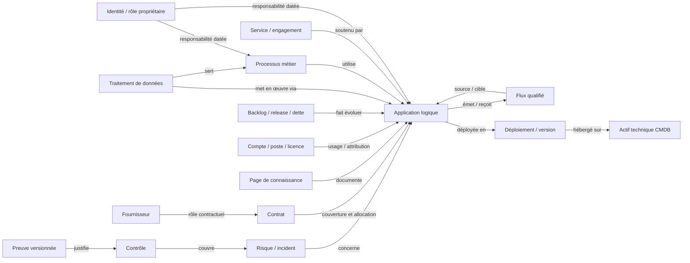

# CIO Assistant — Revue produit, UX et architecture du système de pilotage DSI

**Date :** 22 novembre 2026. **Statut :** diagnostic technique et proposition de trajectoire, à arbitrer ; aucune capacité cible décrite ci-dessous n’est livrée par cette revue.

**Référence auditée :** branche principale, révision `45da38f519d8868786b22d2d3584216cbddcf1b4`. Les liens de preuve sont figés sur cette révision. **Périmètre :** schéma Prisma, validations, services, routes, composants d’interface, catalogue MCP et tests. La demande couvre un système de travail DSI transverse : métier, applications, infrastructure, développement, RSSI, RGPD et environnement de travail, utilisable visuellement et depuis Claude Desktop **et** ChatGPT.

## 1. Diagnostic exécutif

**La cartographie existe, mais sous la forme d’une CMDB technique initiale ; le référentiel applicatif transverse attendu n’existe pas encore.** Le code sait créer des éléments « Application » et « Service SaaS », les rattacher à un service et un prestataire, et enregistrer des liens orientés de dépendance, d’hébergement et de supervision. Les fiches affichent les relations entrantes et sortantes. Ce constat repose sur les modèles, les mutations serveur et les écrans, pas sur le README [E01][E02][E03][E04][E05].

Cette base ne relie pas structurellement une application aux processus métier, aux traitements de données personnelles, aux coûts affectés, aux risques applicatifs ou aux flux qualifiés. Elle n’offre pas de calcul d’impact transitif ni de vue graphique identifiés dans le code inspecté. Les liens d’un service vers un contrat peuvent donner un contexte indirect ; ils ne démontrent ni la couverture contractuelle de chaque application ni son coût complet.

**Le produit est aujourd’hui un outil de pilotage projets/services enrichi d’une mémoire documentaire, pas encore un système d’exploitation complet de la DSI.** Il dispose d’objets réels et réutilisables : projets, actions, jalons, risques génériques, décisions, contrats, budget, services, contrôles et pages versionnées. Ajouter des menus « RGPD » ou « RSSI » sans relations ni workflows durables ne comblerait pas les lacunes [E01][E11][E13].

**L’indépendance vis-à-vis des moteurs IA est engagée, mais l’unification des opérations ne l’est que partiellement.** Une interface fournisseur et trois modes existent : heuristique locale, OpenAI et API compatible [E27][E28]. Le catalogue MCP stdio/HTTP et l’API métier partagent un point d’entrée. En revanche, la CMDB est absente de ce catalogue ; plusieurs parcours web/IA écrivent hors de la passerelle commune [E05][E06][E07][E08][E09][E10][E24].

**La validation humaine n’est pas systématique.** L’import PMO possède aperçu, sélection, vérification de version et transaction. La file de suggestions propose validation/rejet. Mais l’ingestion IA peut créer directement des objets, y compris lors d’un repli heuristique ; les instructions d’un outil MCP invitant le client à demander l’accord ne constituent pas une approbation imposée côté serveur [E14][E15][E22]. Il faut une politique explicite, commune et vérifiable, selon la sensibilité de l’opération.

### Décisions de cadrage recommandées

1. Faire de l’application et du processus métier les pivots du référentiel, en réutilisant la CMDB et les objets existants plutôt qu’en les dupliquant.
2. Prioriser le contrat commun d’opérations, l’identité et l’approbation avant d’étendre les automatismes IA aux nouveaux domaines.
3. Livrer une tranche verticale : **application → processus → hébergement → impact → décision → action → preuve**, utilisable sans IA et par les deux clients IA.
4. Traiter RSSI, RGPD, développement et workplace comme des domaines structurés liés au même référentiel ; ne pas annoncer une équivalence globale avec Notion, Planner ou Trello sans recette comparative convenue.

## 2. Échelle de preuve et séparation des branches

- **Existant :** modèle et parcours d’implémentation identifiés ; cela ne signifie pas « certifié en production ».
- **Partiel :** briques présentes mais relations, périmètre ou workflow incomplets par rapport au besoin.
- **Absent du périmètre inspecté :** aucune entité/service/route dédiée identifiée ; du texte libre ne vaut pas un objet métier.
- **Non testé ici :** code ou documentation présents, mais résultat opérationnel non établi dans cette revue.

La précédente refonte visuelle est un **commit local distinct**, issu de la même base principale, sur la branche locale de refonte. Elle change l’accueil, la navigation, les styles et certains écrans ; elle **n’ajoute pas** de registre RGPD, d’incident RSSI, d’analyse d’impact ou d’opérations CMDB MCP. Son serveur de démonstration et ses essais HTTP ne prouvent pas l’état visuel de `main`. Cette nouvelle branche de revue repart directement de `main` et ne contient aucun de ces changements d’interface. Aucune fusion de la refonte précédente n’est proposée ici.

## 3. Matrice de couverture actuelle

| Domaine / résultat attendu | État | Preuves d’implémentation | Écart déterminant / validation manquante |
|---|---|---|---|
| Pilotage projets, actions, jalons, arbitrages, budget et contrats | Existant, périmètre borné | Relations Prisma, services de portefeuille, catalogue métier [E01][E06] | Pas de rattachement applicatif transverse ; recette métier avec utilisateurs non réalisée |
| Cartographie technique | Existant | `ConfigurationItem`, `ConfigurationRelation`, types application/SaaS/serveur/base/réseau/poste, filtres et fiches [E01][E02][E03][E04][E05] | Dépendances à un saut ; owner libre, pas d’analyse d’impact ni de graphe navigable identifiés |
| Cartographie métier et processus | Absent comme référentiel dédié | Aucun modèle de processus/capacité ; `SupportService` et objectifs existent [E01][E13] | Processus, responsable métier, criticité métier et mesure de valeur à modéliser |
| Infrastructure et continuité | Partiel | Actifs, environnement, criticité, hébergement, services et contrôles [E01][E02][E03][E04][E05][E13] | Pas de plan de continuité/reprise structuré, objectifs RTO/RPO ni exercice rattaché identifiés |
| RSSI | Partiel | `Risk` générique avec impact/probabilité/mitigation ; `ServiceControl` avec auteur, résultat, preuve textuelle et prochaine échéance [E01][E13] | Pas d’incident sécurité dédié, catalogue de contrôles, preuve gérée/versionnée ou liens risque–application identifiés |
| RGPD | Absent comme module structuré | Schéma complet et catalogue métier inspectés [E01][E06] | Pas de traitement, finalité/base légale, demande de droit, durée/règle de conservation, sous-traitance RGPD ou flux de transfert qualifié |
| Développement applicatif | Partiel | Projets de développement, actions et jalons [E01] | Pas de backlog produit typé, release/version déployée, dette technique ou lien application–dépôt–déploiement identifiés |
| Workplace / bureautique | Partiel | Type CMDB `ENDPOINT`, fournisseurs/contrats, services, tickets externes et actions [E01][E02] | Un utilisateur de l’application n’est pas un compte du SI ; pas d’attribution de poste/licence, entitlement ou cycle arrivée-départ identifié |
| Connaissances durables | Existant pour les pages, partiel pour le knowledge graph | Pages en blocs/Markdown, arborescence, révisions auteur, vues métier liées [E01][E11] | Pas de vues liées CMDB dans le catalogue actuel ; partage documentaire fin et backlinks métier à cadrer |
| Fournisseurs IA interchangeables | Existant pour trois modes | Interface `AIProvider`, fabrique et adaptateurs [E10] | Heuristique locale ≠ LLM local ; une API compatible ≠ prise en charge de tous les protocoles fournisseurs ; secrets, résidence et budgets à gouverner |
| Claude Desktop | Implémentation présente ; client réel non testé ici | Extension `.mcpb`, stdio, configuration et catalogue commun [E08][E20] | Pas de session réelle Claude Desktop exécutée dans cette revue |
| ChatGPT | Transport/adaptation partiels ; client réel non testé ici | Route MCP HTTP, configuration Bearer et écran de connexion [E09][E20] | Découverte, authentification et accès réseau du compte ChatGPT cible non vérifiés ; documentation de tunnel ≠ interopérabilité démontrée |
| Droits, audit et approbation communs UI/MCP/API | Partiel | Session, rôles, jetons expirables, scopes lecture/pilotage, passerelle transactionnelle et idempotence [E07][E12][E23] | CMDB et routes historiques hors passerelle ; audit non exhaustif ; pas de politique d’approbation serveur universelle |
| Réversibilité des données | Partiel | Export métier incluant CMDB/pages et révisions, sans tables de secrets/sessions [E21] | Export ≠ restauration vérifiée ; reprise volumétrique et sauvegarde intégrale non testées ici |

Les tests unitaires de la branche auditée passent : **26 fichiers, 103 tests**. Les tests CMDB valident normalisation, filtres, refus d’auto-relation et type de relation inconnu ; ils ne prouvent pas le comportement de suppression, la concurrence, la transitivité ni l’ergonomie [E18]. Le script de recette MCP plus complet est présent mais **n’a pas été exécuté dans cette revue** [E19].

## 4. Cartographie : capacités exactes et limites relationnelles

| Relation attendue autour de l’application | Ce que le code permet aujourd’hui | Évaluation |
|---|---|---|
| Application ↔ identité / cycle de vie | Élément typé application ou SaaS, référence unique facultative, statut planifié/en service/maintenance/retiré, environnement | Initial ; pas de produit logique distinct de ses déploiements/versions [E01][E02] |
| Application ↔ propriétaire | Champ `owner` texte, et responsable structuré du service associé | Partiel ; métier et technique non distingués, pas de FK d’ownership applicatif [E01] |
| Application ↔ service | Une FK `serviceId` facultative | Existant mais cardinalité limitée ; un processus métier n’est pas ce service [E01] |
| Application ↔ actifs techniques | Arêtes orientées `HOSTED_ON`, `DEPENDS_ON`, `MONITORED_BY` entre éléments | Existant pour relations directes, sans validation de couples de types ni boucle multi-nœuds dans le validateur inspecté [E02][E29][E18] |
| Application ↔ fournisseur | Une FK `vendorId` facultative | Existant ; ne décrit pas les rôles multiples éditeur/hébergeur/opérateur [E01] |
| Application ↔ contrat et coût | Aucun lien direct ; chemin éventuel par service → contrat et tables budget/contrats | Contexte indirect uniquement ; pas d’allocation ni de règle anti-double compte [E01] |
| Application ↔ données personnelles | Description libre possible | Absent comme relation exploitable ; une mention textuelle ne suffit pas [E01] |
| Application ↔ flux / interfaces | Dépendance générique uniquement | Pas de protocole, direction de données, fréquence, classification, finalité ni transfert qualifiés [E02] |
| Application ↔ risques / contrôles | Risque lié à projet/prestataire ; contrôle lié au service | Indirect et incomplet, aucun rattachement applicatif explicite [E01][E13] |
| Application ↔ processus / valeur | Aucun modèle dédié trouvé | Absent ; nécessaire pour l’impact métier [E01] |
| Application ↔ projets / releases / dette | Projets existent indépendamment | Pas de relation structurée identifiée ; actions génériques ≠ backlog de release [E01] |
| Analyse d’impact | Consultation de voisins entrants/sortants, navigation de fiche en fiche | Pas de parcours transitif, politique de propagation ou instantané de décision identifié [E03][E04] |

**Conséquence concrète :** un DSI peut enregistrer « ERP hébergé sur serveur A », consulter ses voisins et ouvrir le service rattaché. Il ne peut pas encore demander de manière déterministe : « Si ce serveur est arrêté, quels processus, applications, traitements, contrats et engagements sont touchés, selon quelles chaînes et avec quelles données manquantes ? »

**Parité IA :** la recherche globale web peut retrouver une fiche CMDB, mais les noms d’entités reconnus par les opérations métier/MCP n’incluent ni élément de configuration ni relation. Les vues intégrables aux pages n’incluent pas non plus la CMDB. L’existence d’une fiche humaine ne vaut donc pas accessibilité par les deux clients IA [E06][E08][E11][E25].

## 5. Parcours de bout en bout à concevoir et recetter

| Parcours / acteur | Point de départ et résultat attendu | Appui actuel → manque | Critère de recette cible |
|---|---|---|---|
| Onboarder une application — responsable applicatif + métier | Créer l’application, désigner les propriétaires, relier processus, service, déploiement, données et contrat ; faire valider | Fiche CMDB/service/prestataire → modèle applicatif et contrôle de complétude manquants | Même application consultable dans l’UI, Claude et ChatGPT ; statut « incomplet » explicite si propriétaire ou relation critique manque |
| Préparer un arrêt — exploitation + DSI | Sélectionner un serveur, simuler l’indisponibilité, lister impacts et chemins, préparer l’arbitrage et les actions | Voisins CMDB et décisions/actions → calcul d’impact, périmètre métier et preuve de décision manquants | Graphe avec cycle et actif partagé : résultat borné, dédupliqué, chemins explicables, droits respectés, lacunes affichées |
| Traiter un incident sécurité — RSSI | Qualifier un incident, relier actifs/applications/processus, suivre confinement, décisions et preuves | Risques/actions/contrôles → incident, chronologie, preuves et restrictions manquants | Journal daté, accès restreint, actions attribuées ; aucune conclusion automatique de notification réglementaire |
| Répondre à une demande de droit — DPO + métier | Identifier traitements/applications/sous-traitants concernés, vérifier identité et décision, suivre réponse et preuve | Pages/tâches génériques → registre structuré et workflow droits manquants | Échéance configurable, tâches et décision traçables, preuve minimisée ; pas d’envoi ni d’effacement automatique sans habilitation/validation |
| Livrer une évolution — responsable développement | Relier demande métier, backlog, dépôt, release, environnement et dette ; évaluer l’impact puis valider | Projet/action/jalon → release/version et rattachement applicatif manquants | Chaîne demande → version livrée → application/déploiement consultable ; retour arrière documenté et accepté par un humain |
| Gérer un départ — workplace + manager | Identifier comptes, appareils et licences, planifier révocations/restitutions et constater exécution | Poste CMDB, service/actions → attributions, comptes et licences manquants | Aucun compte RH réel requis pour la recette ; chaque ressource a responsable et état ; acte sensible approuvé, trace d’exécution conservée |
| Préparer le CODIR — DSI | Consolider valeur métier, criticité, risques, coût et décisions du portefeuille ; garder les sources | Rapports et revue existent → coût applicatif et couverture métier manquants | Synthèse reproductible depuis les objets référents, horodatée, avec liens et absence de données signalée ; fonctionnement sans IA |

Chaque parcours doit aboutir à une écriture durable et à des objets liés, pas seulement à une réponse en conversation. Les variantes Claude/ChatGPT devront produire le même état autorisé que l’interface, sous une politique identique.

## 6. Architecture de l’information et vues par responsabilité

### Navigation cible

- **Mon travail** : tâches, validations, alertes et contexte récent ; la personne voit la cause et peut ouvrir la fiche source.
- **Référentiel** : applications, processus/capacités métier, services, infrastructure, flux et propriétaires ; recherche et analyse d’impact comme entrées permanentes.
- **Pilotage** : portefeuille, roadmap, budget, contrats, fournisseurs, décisions et rapports.
- **Domaines** : sécurité, données personnelles, développement et workplace ; vues spécialisées des mêmes objets centraux, pas de silos duplicatifs.
- **Connaissances** : pages versionnées, procédures, preuves référencées et vues vivantes ; les permissions s’appliquent également aux recherches, extraits et exports.
- **Exécution & administration** : propositions, opérations, journaux, droits, clients MCP et moteurs IA. Les modèles sont des fournisseurs interchangeables ; le référentiel et les décisions restent ici.

| Vue cible | Questions prioritaires | Périmètre d’accès recommandé, à décider |
|---|---|---|
| DSI | Quels services/processus sont exposés, où investir, que faut-il arbitrer ? | Synthèse transverse et arbitrages selon délégation ; pas d’accès automatique à toute donnée personnelle sensible |
| RSSI | Quel incident/risque touche quelles applications, quels contrôles/preuves manquent ? | Dossiers sécurité restreints ; séparation des rôles d’exécution et d’approbation pour actes sensibles |
| DPO | Quels traitements, demandes de droits, sous-traitants et conservations concernent un processus ? | Données du registre et dossiers habilités, exposition minimale aux clients IA |
| Responsable applicatif / développement | Quelle application, version, dette et évolution suis-je chargé de maintenir ? | Périmètre d’applications attribuées ; approbation de release selon responsabilité |
| Exploitation / infrastructure | Quelle dépendance, maintenance, reprise et preuve de restauration ? | Périmètre technique et impact autorisé ; masquage des détails sécurité/personnels non nécessaires |
| Workplace / support | Quels comptes, postes, licences et interventions sont à traiter ? | Ressources attribuées et dossiers autorisés ; aucune délégation globale par simple présence dans l’équipe |
| Propriétaire métier | Quel processus, quelle valeur, quel engagement et quelle décision me concernent ? | Services/processus attribués ; lecture des impacts et validation métier |

Le code actuel distingue essentiellement DSI et APPRENTI. Les jetons métiers exigent un titulaire DSI et deux scopes globaux. Ces vues cibles nécessitent de vraies politiques côté serveur, pas seulement un filtrage de menus [E07][E12][E23].

## 7. Diagnostic UX et accessibilité fondé sur les sources

| Observation vérifiable | Effet probable, à confirmer en recette | Amélioration proposée |
|---|---|---|
| CMDB rangée sous un groupe « Exploitation », sans entrée application/processus ; voisins présentés en deux listes [E04][E16] | Le pivot métier et la lecture des chaînes ne sont pas disponibles dans ce parcours | Entrée « Applications & impacts » ; graphe accompagné d’une table accessible et d’un détail de chemin |
| Propriétaire CMDB libre et relations optionnelles ; formulaire retourne une erreur générale sur validation [E01][E05] | Attribution ambiguë et correction de champ peu guidée | Propriétaires référencés, rôles métier/technique, qualité par champ ; erreurs reliées au contrôle concerné |
| Suppression CMDB définitive, retrait des relations, confirmation navigateur [E04][E05] | Rupture de contexte historique lors d’une analyse ou d’un audit | Retrait/archivage avant suppression ; aperçu des liens affectés ; droit dédié et politique de conservation |
| Lecture CMDB et liste des cibles sans pagination ; recherche locale après chargement [E03] | Risque de lenteur et sélection difficile à volume croissant, non mesuré ici | Recherche/pagination côté serveur ; sélecteur de relations filtrable ; budget de performance après mesure de référence |
| Kanban : drag-and-drop **et sélecteur de statut étiqueté** ; erreur annoncée, sélection existante [E17] | Alternative clavier déjà présente ; ne pas présenter le produit comme exclusivement utilisable à la souris | Vérifier focus après déplacement, annonce de succès, toucher, zoom et état d’échec ; conserver cette alternative |
| Shell : lien d’évitement, `main`, dialogues natifs, labels et styles de focus ; groupes repliés [E16][E26] | Bonnes bases sémantiques, sans preuve de conformité complète | Recette clavier/lecteur d’écran ; retour du focus, contraste mesuré, reflow à zoom 200/400 %, focus non masqué |
| Vues de pages limitées à huit familles métier, hors CMDB ; pages réservées DSI [E11][E12] | La mémoire et le référentiel technique ne se composent pas encore pour tous les rôles | Ajouter les vues applicatives et l’ACL documentaire ; liens entrants et sources lisibles selon droits |
| Revue humaine dédiée, mais ingestion IA pouvant enregistrer directement [E14][E15] | L’utilisateur ne dispose pas d’une frontière uniforme entre suggestion et engagement | Afficher avant exécution les objets, changements, coût/résidence connus, règles et approbateur ; confirmation serveur pour les actes soumis à validation |

Aucune capture, mesure de contraste, observation d’utilisateurs ou certification WCAG/RGAA n’a été produite. Les conséquences sont des hypothèses de conception attachées à des mécanismes observés, pas des résultats de tests ergonomiques inventés.

## 8. Modèle référentiel cible et règles de cohérence

**Cible proposée, non présente intégralement dans le schéma actuel.** Faire évoluer les données existantes par migrations compatibles et reprise contrôlée. Un graphe affiché ne nécessite pas d’emblée une base graphe : des tables relationnelles typées et des requêtes bornées sont suffisantes pour une première tranche.

### Objets, cardinalités et contraintes essentielles

| Ensemble cible | Relations et invariant attendu | Réutilisation / migration |
|---|---|---|
| `BusinessProcess`, capacité, service rendu | Processus N–N applications ; propriétaire et criticité métier ; indicateur de valeur avec unité/période/source, pas un score opaque | Garder `SupportService` pour l’exploitation ; relier, ne pas assimiler processus et service |
| `Application` logique + `Deployment` | Une application a N déploiements et N versions ; rattachement explicite à un CI applicatif existant, sans double identité ; cycle de vie distinct de l’état d’un serveur | Reprendre `APPLICATION`/`SAAS`, conserver leurs identifiants ou une table de correspondance traçable |
| `Ownership` | Ressource, personne/équipe, rôle métier/technique, validité ; au moins un responsable accountable ou état d’incomplétude explicite | Convertir le texte `owner` après rapprochement humain ; ne jamais attribuer silencieusement à un homonyme |
| `ApplicationProcess`, `ApplicationService`, dépendances | N–N explicites avec provenance, auteur, date de revue et validité ; types compatibles et direction documentée | Conserver les arêtes CMDB ; séparer dépendance d’exécution et flux de données |
| `DataFlow`, `ProcessingActivity` | Source/cible, finalité, catégories, fréquence, sensibilité et transferts à qualifier ; traitement N–N applications/processus/sous-traitants | Nouveau registre structuré, sans verser des données personnelles réelles dans une démonstration |
| Contrats, fournisseurs, allocations | Rôles N–N éditeur/opérateur/hébergeur ; couverture contractuelle datée ; coûts par période/devise et méthode d’allocation explicite | Réutiliser vendors/contracts/budgets ; préserver les montants historiques, éviter les sommes de natures différentes |
| Risques, incidents, contrôles, preuves | Références applicatives/processus/actifs ; risque intrinsèque/résiduel si retenu ; incident distinct ; preuve avec source, intégrité, accès et conservation | Étendre `Risk`/`ServiceControl` ; texte de preuve existant conservé, pas prétendu pièce probante certifiée |
| Continuité | Analyse d’impact métier, objectifs de reprise, plans et exercices, constat de restauration ; version et approbateur | Lier services/applications/déploiements existants ; objectifs proposés validés par le métier |
| Développement et workplace | Release/backlog/dette liés à l’application ; compte/poste/licence liés à l’identité d’usage, l’application et au service | Ne pas transformer les utilisateurs d’authentification en inventaire des comptes du SI ; ne pas dupliquer les postes CMDB |
| Connaissances et exécution | Pages/révisions, liens typés, propositions/opérations/journal reliés aux objets ci-dessus | Conserver éditeur et historique ; droits identiques sur l’objet, le lien, la recherche et l’export |

**Analyse d’impact :** définir pour chaque type d’arête si une indisponibilité se propage, dans quel sens et sous quelles conditions ; traversée avec ensemble visité, limites de profondeur/périmètre, déduplication et gestion des cycles. Retourner les chemins et la version des relations, distinguer impact connu, hypothèse et couverture inconnue. Les redondances/alternatives ne doivent pas être assimilées automatiquement à des dépendances bloquantes. Une décision garde un instantané de l’analyse et ses hypothèses. Les résultats et chemins sont filtrés selon les habilitations, y compris avant envoi à un fournisseur IA.

## 9. Exécution commune, neutralité IA, identité et audit

### Ce qui existe et ce qui manque

La passerelle commune assure déjà authentification du jeton, vérification de titulaire, scope, transaction, clé d’idempotence et version obligatoire pour les pages ; les outils MCP de mise à jour exigent une version. Elle mémorise acteur, origine et connecteur dans la réponse enregistrée. Ce mécanisme est utile, mais ne constitue pas un journal exhaustif et immuable de tous les changements [E07].

Les routes web historiques réutilisent souvent les mêmes services de domaine, **sans passer par les mêmes enveloppes d’écriture** ; la CMDB écrit directement avec Prisma. La revue de suggestion crée une entité puis marque la revue approuvée en deux appels distincts, sans acteur approbateur passé à cette fonction. Le risque de doublon ou d’état partiel en cas de rejeu/concurrence doit être reproduit et corrigé ; aucun incident réel n’est affirmé ici [E05][E15][E24].

### Contrat cible

1. **Catalogue sémantique versionné :** mêmes commandes et requêtes pour UI/API/MCP, schémas d’entrée/sortie, erreurs métier et liens canoniques. Ajouter application, processus, CI, relations, flux, impact et registres. Les adaptateurs de transport n’écrivent pas directement en base.
2. **Identité de délégation :** distinguer utilisateur humain, client (Claude Desktop/ChatGPT/autre), session/exécution et modèle éventuellement appelé. Conserver identité d’origine et approbateur ; permissions par ressource/action, non par nom de fournisseur. Révocation, expiration et scopes minimaux restent imposés côté serveur.
3. **Politique d’autorisation :** lecture, proposition, approbation et engagement séparés. Les résultats de recherche, le graphe, les extraits et exports appliquent les mêmes droits. L’UI masque les actions interdites sans devenir le contrôle de sécurité.
4. **Cycle d’opération durable :** `brouillon → proposé → approuvé/rejeté → en cours → réussi/échoué/annulé`, avec corrélation, auteur, diff, sources et versions. Les actes soumis à approbation ne peuvent être engagés ni par le chat ni par une clé MCP sans décision valide côté serveur. L’approbation expire ou est invalidée si le périmètre/version change.
5. **Cohérence transactionnelle :** engagement, contrôle de version, audit et état d’approbation atomiques ; idempotence au niveau opération et sous-étape. Pour une action externe, file/outbox avec état et reprise ; ne pas prétendre à une transaction distribuée entre fournisseurs.
6. **Journal d’activité :** événements attribués, date, objet/relations, avant/après ou références de versions, canal, résultat/refus, politique et approbation ; rétention et accès définis, secrets exclus. Une lecture d’objet sensible peut nécessiter un événement dédié. Le journal technique d’idempotence reste distinct du journal d’audit.
7. **Moteurs pluggables :** conserver `AIProvider`, ajouter capacités déclarées, schémas validés et tests de contrat, délais, coût/plafonds, mode de repli explicite et politique d’envoi de données. Un moteur suggère ; l’application valide les opérations. Le modèle ne devient ni la source de vérité ni le contrôleur des permissions.
8. **Parité Claude Desktop / ChatGPT :** maintenir les deux parcours de connexion, documenter ce qui est effectivement supporté par les comptes cibles ; choisir le mécanisme d’authentification approprié après essais. Un transport MCP générique et un Bearer ne prouvent pas à eux seuls la compatibilité de chaque environnement client. Les noms historiques `ClaudeToken`/`ClaudeWrite` peuvent être migrés sans rupture vers une terminologie neutre ; la priorité reste le comportement et les données.

### Recette commune obligatoire

Pour un même utilisateur habilité, réaliser depuis UI, Claude Desktop réel et ChatGPT réel : découverte/lecture d’une application et de son impact, proposition d’une modification, refus si hors périmètre, approbation par le rôle prévu, engagement unique, visibilité immédiate dans les trois interfaces, rejeu idempotent, conflit de version et révocation. Vérifier l’identité du client et de l’approbateur dans le journal. Répéter avec un client en lecture seule et un moteur alternatif. Les preuves doivent indiquer clients/comptes/versions/réseau utilisés sans publier de secrets.

## 10. Feuille de route priorisée et conditions de passage

Les priorités indiquent l’ordre et le risque, **pas une estimation d’effort ou une date promise**. Les tickets liés au dossier de revue constituent le backlog de cadrage ; leurs sous-lots doivent rester démontrables.

| Lot | Priorité / dépendances | Résultat métier | Conditions d’acceptation principales |
|---|---|---|---|
| A — Référentiel applicatif et processus | P0 ; décisions de modèle et propriétaires | Une application reconnue partout, reliée à son contexte métier | Reprise des CI existants ; liens métier/technique/contrat/données/risques ; provenance ; complétude ; pas de doublon ni perte à la migration |
| B — Opérations, droits, approbation et audit communs | P0 ; démarre avec A, contrat partagé préalable aux automatismes | Même opération, mêmes droits et même trace via tous les canaux | CMDB dans le catalogue ; écritures hors passerelle inventoriées et migrées ; conflits/rejeux ; approbation serveur ; recette réelle Claude **et** ChatGPT |
| C — Impact et continuité | P1 ; A + B | Préparer une maintenance ou une reprise avec impacts expliqués | Traversée bornée/cycles ; chemins et inconnues ; comparaison liste/graphe ; objectifs/reprise/exercice et preuve liés ; décision figée |
| D — Sécurité RSSI | P1 ; A + B ; réutilise C | Qualifier incidents/risques, suivre mesures et preuves | Incident distinct du risque ; liens au référentiel ; contrôle/échéance/propriétaire ; preuve protégée ; journal ; absence de conclusion réglementaire automatique |
| E — Registre et workflows RGPD | P1 ; A + B ; coordination D | Suivre traitements, sous-traitants, droits et conservation | Objets structurés, liens applications/processus/flux ; ACL ; demandes avec échéances configurées ; décision/proof ; aucune revendication de conformité automatique |
| F — Développement applicatif | P2 ; A + B, impact C pour release | Relier besoin, backlog, release, déploiement et dette | Traçabilité versionnée, critère d’acceptation, liens dépôt externes ; décision de release et retour arrière ; pas d’exécution de déploiement implicitement autorisée |
| G — Workplace | P2 ; A + B ; D/E pour opérations sensibles | Ressources, comptes et licences attribués et suivis | Inventaire relié, arrivée/mobilité/départ, états/preuves, récupération de licences ; refus d’acte non habilité ; aucun compte du SI créé par cette revue |
| H — Parcours et qualité UX par rôle | Transverse dès P0 ; chaque domaine ajouté après son socle | Un humain comprend et réalise les parcours sans IA | Tests de scénarios avec utilisateurs représentatifs ; navigation et erreurs cohérentes ; clavier/zoom/lecteur d’écran ; graphe + table ; états vide/chargement/conflit ; aucune régression des parcours existants |

**Premier jalon d’acceptation :** application de démonstration associée à un processus, propriétaire, service, serveur, contrat et traitement ; incident ou maintenance simulé ; impact expliqué ; décision et action validées ; preuve et page référencées ; même état visible dans l’UI, Claude et ChatGPT. Tant que ce jalon n’est pas démontré, le produit doit être présenté comme une plateforme de pilotage en extension, pas comme un remplacement complet des outils demandés.

**Mesure après référence initiale :** temps et réussite des parcours, doublons, liens incomplets/périmés, refus de droits, rejouabilité, cohérence inter-clients et recherche. Les cibles de performance seront fixées avec volumes et environnement convenus ; aucun benchmark ni gain chiffré n’est inventé.

## 11. Validation, publication et limites

- Sources de `main` inspectées dans un checkout de revue distinct. Aucun schéma, service, interface ou donnée métier modifié par cette livraison documentaire.
- Tests existants relancés sur ce checkout : 26 fichiers, 103 tests réussis. Les tests utilisent notamment des doublures de services ; le résultat n’équivaut pas à une validation production, de charge ou d’interopérabilité réelle.
- Les capacités MCP HTTP/stdio et l’extension sont établies par le code. Le script d’intégration existe [E19] mais n’est pas relancé ici ; aucun essai réel Claude Desktop/ChatGPT ni compte Microsoft/fournisseur externe utilisé.
- Pas de test d’intrusion, de conformité RGPD, de certification RGAA/WCAG, de recette visuelle interactive ou de comparaison fonctionnelle mesurée avec des produits tiers. Les fonctions absentes sont celles non identifiées dans le schéma/catalogue/services/routes inspectés ; une extension privée extérieure au dépôt n’est pas évaluée.
- Les essais cloud de la refonte précédente sont distincts ; ils utilisaient une base temporaire. Aucun portail d’aperçu distant n’est actuellement fourni. Aucun hébergement payant ni déploiement production engagé.
- Recherche d’issues et PR existantes : aucune remontée par le connecteur, confirmée par l’API du dépôt. Aucun tableau Projects v2 rattaché au dépôt retourné ; la lecture des tableaux personnels du propriétaire est refusée à l’intégration. Les issues du dépôt et la PR documentaire constituent donc la livraison fiable. **Aucune affectation à un tableau personnel non accessible n’est revendiquée.**

## 12. Index des preuves de code

Tous les liens ci-dessous pointent vers la révision de référence auditée, pas vers la branche locale de refonte.

[E01]: https://github.com/nebunamirax/cioAssistant/blob/45da38f519d8868786b22d2d3584216cbddcf1b4/prisma/schema.prisma#L10-L515
[E02]: https://github.com/nebunamirax/cioAssistant/blob/45da38f519d8868786b22d2d3584216cbddcf1b4/lib/domain/cmdb.ts#L1-L37
[E03]: https://github.com/nebunamirax/cioAssistant/blob/45da38f519d8868786b22d2d3584216cbddcf1b4/lib/services/cmdb-service.ts#L9-L53
[E04]: https://github.com/nebunamirax/cioAssistant/blob/45da38f519d8868786b22d2d3584216cbddcf1b4/app/cmdb/%5Bid%5D/page.tsx#L15-L109
[E05]: https://github.com/nebunamirax/cioAssistant/blob/45da38f519d8868786b22d2d3584216cbddcf1b4/app/cmdb/mutations.ts#L12-L68
[E06]: https://github.com/nebunamirax/cioAssistant/blob/45da38f519d8868786b22d2d3584216cbddcf1b4/lib/business/contracts.ts#L23-L44
[E07]: https://github.com/nebunamirax/cioAssistant/blob/45da38f519d8868786b22d2d3584216cbddcf1b4/lib/business/gateway.ts#L22-L123
[E08]: https://github.com/nebunamirax/cioAssistant/blob/45da38f519d8868786b22d2d3584216cbddcf1b4/mcp/tools.ts#L13-L89
[E09]: https://github.com/nebunamirax/cioAssistant/blob/45da38f519d8868786b22d2d3584216cbddcf1b4/app/api/mcp/route.ts#L14-L45
[E10]: https://github.com/nebunamirax/cioAssistant/blob/45da38f519d8868786b22d2d3584216cbddcf1b4/lib/ai/provider-factory.ts#L9-L28
[E11]: https://github.com/nebunamirax/cioAssistant/blob/45da38f519d8868786b22d2d3584216cbddcf1b4/lib/services/workspace-service.ts#L33-L110
[E12]: https://github.com/nebunamirax/cioAssistant/blob/45da38f519d8868786b22d2d3584216cbddcf1b4/lib/auth/session.ts#L23-L38
[E13]: https://github.com/nebunamirax/cioAssistant/blob/45da38f519d8868786b22d2d3584216cbddcf1b4/lib/services/support-service.ts#L5-L26
[E14]: https://github.com/nebunamirax/cioAssistant/blob/45da38f519d8868786b22d2d3584216cbddcf1b4/lib/services/ai-intake-service.ts#L668-L853
[E15]: https://github.com/nebunamirax/cioAssistant/blob/45da38f519d8868786b22d2d3584216cbddcf1b4/lib/services/ai-intake-review-service.ts#L455-L488
[E16]: https://github.com/nebunamirax/cioAssistant/blob/45da38f519d8868786b22d2d3584216cbddcf1b4/components/layout/workspace-navigation.ts#L5-L41
[E17]: https://github.com/nebunamirax/cioAssistant/blob/45da38f519d8868786b22d2d3584216cbddcf1b4/components/actions/action-kanban-view.tsx#L92-L229
[E18]: https://github.com/nebunamirax/cioAssistant/blob/45da38f519d8868786b22d2d3584216cbddcf1b4/tests/cmdb-schema.test.ts#L4-L27
[E19]: https://github.com/nebunamirax/cioAssistant/blob/45da38f519d8868786b22d2d3584216cbddcf1b4/scripts/verify-shared.ts#L264-L410
[E20]: https://github.com/nebunamirax/cioAssistant/blob/45da38f519d8868786b22d2d3584216cbddcf1b4/app/settings/integrations/claude/page.tsx#L25-L86
[E21]: https://github.com/nebunamirax/cioAssistant/blob/45da38f519d8868786b22d2d3584216cbddcf1b4/app/api/export/business/route.ts#L4-L32
[E22]: https://github.com/nebunamirax/cioAssistant/blob/45da38f519d8868786b22d2d3584216cbddcf1b4/lib/services/pmo-intake-service.ts#L250-L295
[E23]: https://github.com/nebunamirax/cioAssistant/blob/45da38f519d8868786b22d2d3584216cbddcf1b4/proxy.ts#L4-L34
[E24]: https://github.com/nebunamirax/cioAssistant/blob/45da38f519d8868786b22d2d3584216cbddcf1b4/app/api/projects/route.ts#L28-L35
[E25]: https://github.com/nebunamirax/cioAssistant/blob/45da38f519d8868786b22d2d3584216cbddcf1b4/app/api/workspace/search/route.ts#L32-L89
[E26]: https://github.com/nebunamirax/cioAssistant/blob/45da38f519d8868786b22d2d3584216cbddcf1b4/components/layout/sidebar.tsx#L40-L106
[E27]: https://github.com/nebunamirax/cioAssistant/blob/45da38f519d8868786b22d2d3584216cbddcf1b4/lib/ai/types.ts#L22-L39
[E28]: https://github.com/nebunamirax/cioAssistant/blob/45da38f519d8868786b22d2d3584216cbddcf1b4/lib/ai/providers/local-provider.ts#L45-L60
[E29]: https://github.com/nebunamirax/cioAssistant/blob/45da38f519d8868786b22d2d3584216cbddcf1b4/lib/validation/cmdb.ts#L11-L38

| Repère | Source et justification |
|---|---|
| [E01] | Schéma complet : relations présentes et familles métier absentes ; CMDB en fin de fichier |
| [E02] | Typologie des actifs, états/environnements et trois types de dépendances |
| [E03] | Requêtes d’inventaire, voisins directs et sélection non paginée des cibles |
| [E04] | Fiche CMDB, voisins entrants/sortants, formulaires et suppression définitive |
| [E05] | Écritures CMDB directes Prisma, restriction DSI, erreurs et relations |
| [E06] | Ensemble fermé des entités accessibles via le contrat commun, hors CMDB |
| [E07] | Autorisation, scopes, transaction, idempotence et contrôle de version ; réponse enregistrée |
| [E08] | Catalogue MCP commun aux transports, écritures versionnées et lectures de pages |
| [E09] | Transport HTTP activable et authentifié, sans preuve de client réel |
| [E10] | Sélection des trois adaptateurs et repli local |
| [E11] | Historique documentaire et catalogue des vues liées sans CMDB |
| [E12][E23] | Session, rôle DSI et périmètre APPRENTI ; contrôles d’origine côté proxy |
| [E13] | Contrôles de services avec correction ajoutée et historique original conservé |
| [E14] | Chemins d’écriture directe depuis plan/décision IA et repli heuristique |
| [E15] | Résolution d’une suggestion en deux écritures, sans acteur approbateur en argument |
| [E16][E17] | Organisation des menus et alternative au drag-and-drop via sélecteur étiqueté |
| [E18][E19] | Portée réelle des tests CMDB ; recette inter-transports présente mais non exécutée ici |
| [E20] | Parcours de configuration distincts Claude Desktop et ChatGPT/MCP HTTP |
| [E21] | Export métier comprenant CMDB et pages, distinct d’une restauration |
| [E22] | Import PMO avec sélection, contrôle de version et transaction |
| [E24][E25] | Route web historique hors enveloppe commune ; recherche CMDB disponible dans l’UI |

Compléments : [E26] décrit le shell accessible dans le code ; [E27][E28] distinguent contrat fournisseur et heuristique locale ; [E29] délimite la validation actuelle des relations CMDB.
